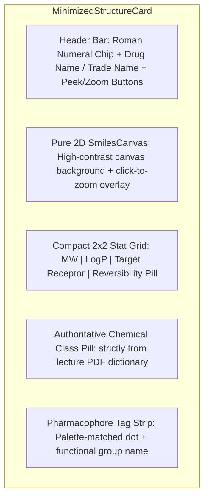
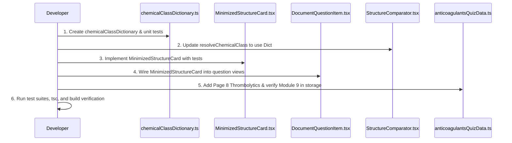

# Design Spec: Minimized Structure Cards, Core Module 9 (Anticoagulants) Migration, and Authoritative Lecture Chemical Class Resolution

**Date**: 2026-11-05  
**Topic**: Minimized Structure Cards in Question Views, Module 9 Core Integration & Thrombolytics, Authoritative Chemical Class Resolution (Zero "N/A")  
**Status**: Ready for Approval  

---

## 1. Intent & The Why

Medical and pharmacy students studying cardiovascular medicinal chemistry on this platform encounter referenced chemical structures at multiple stages: in comparative study (`StructureComparator`), in full-table matrix review (`MedChemMatrix`), and while answering practice and exam questions (`DocumentQuestionItem`).

Three critical usability and pedagogical gaps currently exist:
1. **Disparate & Bulky Structure Rendering in Question Views**:
   In question views (`DocumentQuestionItem.tsx`), referenced chemical structures are currently rendered using ad-hoc raw text divs and unstyled tags that differ significantly from the sleek, high-contrast design of `StructureComparator.tsx`. When questions display multiple referenced structures (e.g. Structure I vs Structure II), these cards consume excessive vertical space without providing the clean stat badges (Molecular Weight, LogP, Target Receptor, Reversibility, and Route of Administration) or pharmacophore color highlights available in the comparator.
2. **Missing Chemical Class Information ("N/A" Defect)**:
   In `StructureComparator.tsx`, `ChemicalStructureCard.tsx`, and `DocumentQuestionItem.tsx`, the Chemical Class field frequently displays `"N/A"` or falls back to generic `"Small molecule compound"`. While target receptors have a robust multi-source resolution pipeline with fallback dictionaries, `resolveChemicalClass()` has no dictionary fallback. Ingested Dexie drugs, merged structures, and inline question structures that lack an explicit `.chemicalClass` property fail to resolve, degrading exam prep quality where students are explicitly tested on chemical classifications (e.g. *Thienopyridine*, *Phenoxy propyloxyamine*, *Tetrahydroquinoline sulfonamide*, *Oxazolidinone*).
3. **Module 9 (Anticoagulants) Permanent Core Curriculum**:
   Module 9 (Anticoagulants) has been developed from Dr. Rami A. Al-Horani's MCP II course materials (7-page review worksheet and 16-slide lecture deck). It must be permanently established as a first-class built-in module that loads alongside Module 8 (Antiplatelets), Module 10 (Heart Failure), and Module 11 (Antiarrhythmics) on first launch, with Chapter 8 (Antiplatelets) remaining the default active module. Furthermore, lecture Slides 30–31 introduce Fibrinolytic / Thrombolytic agents (Alteplase, Reteplase, Tenecteplase, Streptokinase, Urokinase), which must be incorporated to complete the module.

---

## 2. Goals, Non-Goals & Anti-Goals

### Goals
- **G1 (Dedicated `MinimizedStructureCard.tsx`)**:
  Create a modular, reusable component modeled after the compound cards in `StructureComparator.tsx`, tailored specifically for question views (`DocumentQuestionItem.tsx`).
  - High-contrast pure 2D `SmilesCanvas` with click-to-zoom affordance.
  - Structure label / Roman numeral chip selector (`Structure I`, `Structure II`).
  - Drug name and trade name display with study-mode peek/hide toggle and exam-mode blinding (`[Blinded for exam]`).
  - Compact 2×2 stat badges: **Molecular Weight**, **LogP**, **Target Receptor**, **Reversibility** (emerald for reversible, rose for irreversible), and **Route/State**.
  - Authoritative Chemical Class badge.
  - Interactive pharmacophore pills strip with palette-matched color dots.
- **G2 (Authoritative Chemical Class Dictionary `chemicalClassDictionary.ts`)**:
  Build a comprehensive master lookup grounded strictly in Dr. Rami A. Al-Horani's MCP II course lecture PDFs across all 4 core modules:
  - **Module 8 (Antiplatelets)**: Salicylate, Thienopyridines (1st/2nd/3rd gen), Cyclopentyltriazolopyrimidine (CPTP), ATP analogues, Himbacine-derived peptidomimetic, Cyclic heptapeptides, Non-peptide tyrosine peptidomimetics, Pyrimidopyrimidines, Quinolinones.
  - **Module 9 (Anticoagulants & Thrombolytics)**: Sulfated polysaccharides / Glycosaminoglycans (UFH, LMWH), Synthetic sulfated pentasaccharides (Fondaparinux), 4-Hydroxycoumarins (Warfarin), Tetrahydroquinoline sulfonamides (Argatroban), Benzimidazole peptidomimetics & double prodrugs (Dabigatran / Dabigatran etexilate), Bivalent polypeptides (Bivalirudin, Desirudin), Oxazolidinones (Rivaroxaban), Pyrazolo-tetrahydropyridinones (Apixaban), Diamino-cyclohexanes (Edoxaban), Amino-methoxy benzamides (Betrixaban), Recombinant t-PA polypeptides, Bacterial proteins, and Renal enzymes.
  - **Module 10 (Heart Failure)**: Cardiac glycosides / Steroidal lactones, Sulfhydryl / Dicarboxylate / Phosphinate ACE inhibitors, Biphenyl tetrazole / non-heterocyclic ARBs, Biphenyl ethyl ester prodrugs (Sacubitril), Steroidal mineralocorticoid receptor antagonists, Anthranilic acid loop diuretics, Benzothiadiazines, Benzazepines (Ivabradine), Bipyridines (Milrinone), Aryloxypropanolamines, C-aryl glucosides (SGLT2), Synthetic catecholamines.
  - **Module 11 (Antiarrhythmics)**: Cinchona alkaloids, p-Amino benzamides, Pyridineacetamides, Aminoacyl-2,6-xylidines / Xylene amides, 2,6-Xylyloxyalkylamines, Fluorinated benzamide piperidines, Aryloxypropanolamines, 2-Butylbenzofurans, Methanesulfonanilides, Bis-methanesulfonamides, Phenylalkylamines, Benzothiazepines, Purine nucleosides.
- **G3 (Zero "N/A" Resolution Across UI)**:
  Update `resolveChemicalClass()` in `StructureComparator.tsx`, `getChemicalClass()` in `src/utils/structureDataUtils.ts`, `ChemicalStructureCard.tsx`, and `MedChemMatrix.tsx` to pass all drug names, IDs, canonical keys, and PubChem CIDs through `chemicalClassDictionary.ts`. For all course compounds, Chemical Class will NEVER render `"N/A"`, `"0"`, or `"Small molecule compound"`.
- **G4 (Module 9 Core Registration)**:
  Ensure `src/utils/moduleStorage.ts` reliably loads all 4 core modules (`antiplatelets_mcp2`, `anticoagulants_mcp2`, `heart_failure_mcp2`, `antiarrhythmics_mcp2`) in `loadAllReviewModules()` and `initModuleStorageFromDexie()`. Guarantee `loadActiveModuleId()` defaults to `antiplatelets_mcp2`.
- **G5 (Thrombolytics Section in Module 9)**:
  Extend `src/data/anticoagulantsQuizData.ts` with Page 8: Fibrinolytic / Thrombolytic Agents from lecture Slides 30–31, covering Alteplase, Reteplase, Tenecteplase, Streptokinase, and Urokinase (indications, bleeding risk, and mechanism of plasminogen activation).

### Non-Goals
- Altering structure cards inside `DocumentStudioModal.tsx`, `ModuleEditorModal.tsx`, or ingestion workflows (user explicitly scoped: *replace referenced structures across question views only*).
- Modifying question stems or scoring rules in Module 8, 10, or 11.
- Querying external third-party chemical APIs at runtime for chemical classes; all classifications must be statically grounded in the course PDFs.

### Anti-Goals
- **AG1**: Dropping interactive features (peek drug names, zoom modal, chip toggling) when migrating question view structure cards.
- **AG2**: Falling back to vague taxonomy strings like `"Small molecule compound"` or `"Active Drug"` when the course lecture explicitly defines the exact chemical scaffold.
- **AG3**: Overriding the user's active module on subsequent sessions (if user previously selected Heart Failure or Antiarrhythmics, respect their saved session).

---

## 3. Architecture & Component Design

### 3.1 `src/components/MinimizedStructureCard.tsx`
This new component encapsulates the visual language of `StructureComparator.tsx`'s compound card, condensed for multi-column grids in quiz question headers.



#### Props Interface
```typescript
export interface MinimizedStructureCardProps {
  structure: ChemicalStructure;
  isSelected?: boolean;
  onToggleSelect?: (structureId: string) => void;
  onZoom?: (structure: ChemicalStructure) => void;
  examModeActive?: boolean;
  isNamePeeked?: boolean;
  onTogglePeek?: (structureId: string) => void;
  showPharmacophores?: boolean;
  className?: string;
}
```

#### Layout & Styling Details
1. **Header**:
   - Left: Chip button (`Structure I`, `Structure II`) with active blue ring state.
   - Center: Drug name in bold with parenthesized trade name; when exam mode is active or blinded, displays italicized `[Blinded for exam]`.
   - Right: Quick icon actions:
     - `Eye` / `EyeOff` button for individual peek.
     - `ZoomIn` button triggering full 2D inspection modal.
     - `ExternalLink` to PubChem compound page if `cid` exists.
2. **Canvas Area**:
   - Responsive `aspect-[4/3]` container with `bg-[var(--structure-canvas-bg)]`.
   - Renders `SmilesCanvas` with `canonicalSmiles || smiles || pubchemMolBlock`.
   - Subtle hover badge: `"Click to zoom"`.
3. **Stat Badges Grid**:
   - **MW**: Formatted molecular weight (`326.4 g/mol`).
   - **LogP**: Formatted partition coefficient (`2.1` or `—`).
   - **Target**: High-yield target receptor badge (`Thrombin`, `Factor Xa`, `P2Y12`, `Nav1.5`).
   - **Reversibility**: Color-coded pill (emerald for `Reversible`, rose for `Irreversible`).
4. **Authoritative Chemical Class Bar**:
   - Prominent badge displaying `resolveChemicalClass(structure)`, e.g.:
     `Oxazolidinone peptidomimetic` or `Thienopyridine prodrug`.
5. **Pharmacophore Tags**:
   - If `structure.pharmacophores` exist, renders compact pills matching `PHARMACOPHORE_PALETTE`.

---

### 3.2 Authoritative Chemical Class Dictionary (`src/utils/chemicalClassDictionary.ts`)

A dedicated, comprehensive dictionary mapping all known drug names, aliases, canonical keys, and PubChem CIDs to their authoritative chemical class according to Dr. Rami A. Al-Horani's lecture slides:

```typescript
export const AUTHORITATIVE_CHEMICAL_CLASSES: Record<string, string> = {
  // === CHAPTER 8: ANTIPLATELETS ===
  'aspirin': 'Salicylate (acetylated salicylic acid)',
  'acetylsalicylic acid': 'Salicylate (acetylated salicylic acid)',
  'ticlopidine': 'Thienopyridine (1st generation prodrug)',
  'clopidogrel': 'Thienopyridine (2nd generation prodrug)',
  'prasugrel': 'Thienopyridine (3rd generation prodrug)',
  'ticagrelor': 'Cyclopentyltriazolopyrimidine (CPTP / nucleoside analog)',
  'cangrelor': 'ATP analogue (non-thienopyridine nucleotide)',
  'vorapaxar': 'Himbacine-derived tricyclic peptidomimetic',
  'eptifibatide': 'Cyclic heptapeptide',
  'tirofiban': 'Non-peptide tyrosine peptidomimetic',
  'abciximab': 'Chimeric monoclonal antibody fragment (Fab)',
  'dipyridamole': 'Pyrimidopyrimidine derivative',
  'cilostazol': 'Quinolinone derivative',

  // === CHAPTER 9: ANTICOAGULANTS & THROMBOLYTICS ===
  'unfractionated heparin': 'Sulfated polysaccharide / Glycosaminoglycan',
  'heparin': 'Sulfated polysaccharide / Glycosaminoglycan',
  'enoxaparin': 'Depolymerized sulfated oligosaccharide (LMWH)',
  'dalteparin': 'Depolymerized sulfated oligosaccharide (LMWH)',
  'tinzaparin': 'Depolymerized sulfated oligosaccharide (LMWH)',
  'fondaparinux': 'Synthetic sulfated pentasaccharide',
  'warfarin': '4-Hydroxycoumarin derivative',
  'argatroban': 'Tetrahydroquinoline sulfonamide / L-Arginine peptidomimetic',
  'dabigatran': 'Benzimidazole-derived peptidomimetic',
  'dabigatran etexilate': 'Benzimidazole double prodrug (carbamate & ester)',
  'bivalirudin': 'Bivalent synthetic 20-amino acid peptide',
  'desirudin': 'Bivalent recombinant 65-amino acid polypeptide',
  'rivaroxaban': 'Oxazolidinone peptidomimetic',
  'apixaban': 'Pyrazolo-tetrahydropyridinone peptidomimetic',
  'edoxaban': 'Diamino-cyclohexane peptidomimetic',
  'betrixaban': 'Amino-methoxy benzamide peptidomimetic',
  'alteplase': 'Recombinant human tissue plasminogen activator (rh-tPA)',
  'reteplase': 'Recombinant mutant deletion t-PA glycoprotein',
  'tenecteplase': 'Recombinant triple-mutant t-PA glycoprotein',
  'streptokinase': 'Bacterial non-enzymatic protein',
  'anistreplase': 'Anisoylated plasminogen-streptokinase complex (APSAC)',
  'urokinase': 'Two-chain serine protease renal enzyme (u-PA)',

  // === CHAPTER 10: HEART FAILURE ===
  'digoxin': 'Cardiac glycoside (steroidal cardenolide lactone)',
  'digitoxin': 'Cardiac glycoside (steroidal cardenolide lactone)',
  'captopril': 'Sulfhydryl-containing ACE inhibitor',
  'enalapril': 'Dicarboxylate-containing ACE inhibitor prodrug',
  'enalaprilat': 'Dicarboxylate-containing ACE inhibitor',
  'lisinopril': 'Dicarboxylate-containing ACE inhibitor (lysine analogue)',
  'ramipril': 'Dicarboxylate-containing ACE inhibitor prodrug',
  'benazepril': 'Dicarboxylate-containing ACE inhibitor prodrug',
  'fosinopril': 'Phosphinate-containing ACE inhibitor prodrug',
  'fosinoprilat': 'Phosphinate-containing ACE inhibitor',
  'losartan': 'Biphenyl imidazole ARB',
  'valsartan': 'Biphenyl non-heterocyclic ARB',
  'candesartan': 'Biphenyl benzimidazole ARB prodrug',
  'candesartan cilexetil': 'Biphenyl benzimidazole ARB prodrug',
  'irbesartan': 'Biphenyl spiro-cyclopentyl ARB',
  'sacubitril': 'Biphenyl ethyl ester prodrug (neprilysin inhibitor)',
  'sacubitrilat': 'Biphenyl carboxylic acid active form (neprilysin inhibitor)',
  'spironolactone': 'Steroidal 17-spironolactone (aldosterone antagonist)',
  'eplerenone': '9,11-Epoxysteroidal lactone (selective aldosterone antagonist)',
  'furosemide': 'Anthranilic acid derivative (sulfonamide loop diuretic)',
  'bumetanide': '3-Aminobenzoic acid derivative (sulfonamide loop diuretic)',
  'torsemide': 'Pyridine-sulfonylurea loop diuretic',
  'hydrochlorothiazide': 'Benzothiadiazine (thiazide diuretic)',
  'ivabradine': 'Benzazepine derivative (HCN channel blocker)',
  'milrinone': 'Bipyridine carbonitrile derivative (PDE3 inhibitor)',
  'carvedilol': 'Carbazole / aryloxypropanolamine (non-selective beta & alpha-1 blocker)',
  'metoprolol': 'Aryloxypropanolamine (selective beta-1 blocker)',
  'bisoprolol': 'Aryloxypropanolamine (selective beta-1 blocker)',
  'atenolol': 'Aryloxypropanolamine (selective beta-1 blocker)',
  'dapagliflozin': 'C-aryl glucoside (SGLT2 inhibitor)',
  'empagliflozin': 'C-aryl glucoside (SGLT2 inhibitor)',
  'dobutamine': 'Synthetic catecholamine (beta-1 adrenergic agonist)',
  'hydralazine': 'Phthalazine hydrazine derivative',
  'isosorbide dinitrate': 'Organic nitrate ester (nitrovasodilator)',
  'isosorbide mononitrate': 'Organic nitrate ester (nitrovasodilator)',

  // === CHAPTER 11: ANTIARRHYTHMICS ===
  'quinidine': 'Cinchona alkaloid (quinoline-quinuclidine diastereomer)',
  'procainamide': 'p-Amino benzamide (procaine ester analogue)',
  'disopyramide': 'Amino butamide (alpha-phenylpyridineacetamide derivative)',
  'lidocaine': 'Aminoacyl-2,6-xylidine (xylene amide)',
  'mexiletine': '2,6-Xylyloxyalkylamine (ether analogue of lidocaine)',
  'flecainide': 'Fluorinated benzamide piperidine (bis-trifluoroethoxy benzamide)',
  'propafenone': 'Phenoxy propyloxyamine (aryloxypropanolamine / phenylpropanone)',
  'propranolol': 'Aryloxypropanolamine (non-selective beta-blocker)',
  'esmolol': 'Aryloxypropanolamine methyl ester (ultra-short beta-blocker)',
  'amiodarone': '2-Butylbenzofuran / diiodophenyl derivative',
  'dronedarone': '2-Butylbenzofuran / methanesulfonamide derivative',
  'sotalol': 'Methanesulfonanilide phenylethanolamine',
  'dofetilide': 'Bis-methanesulfonamide phenethylamine',
  'ibutilide': 'Methanesulfonanilide heptanamide',
  'verapamil': 'Phenylalkylamine (calcium channel blocker)',
  'diltiazem': 'Benzothiazepine (calcium channel blocker)',
  'adenosine': 'Purine nucleoside',
};
```

#### Lookup Pipeline in `resolveChemicalClass()`
```typescript
export function resolveChemicalClass(drug?: Partial<ChemicalStructure> | null): string {
  if (!drug) return 'N/A';

  // 1. Direct explicit property (if not 'N/A', '0', '—', or 'Small molecule compound')
  const explicit = drug.chemicalClass || (drug as any).chemical_class || ...;
  if (isValidClass(explicit)) return explicit.trim();

  // 2. Canonical dictionary lookup by name, id, or tradeName
  const fromDict = getChemicalClassFromDictionary(drug.name) ||
                   getChemicalClassFromDictionary(drug.id) ||
                   getChemicalClassFromDictionary((drug as any).tradeName);
  if (fromDict) return fromDict;

  // 3. PubChem CID lookup
  const cid = drug.cid || (drug as any).pubchemAudit?.cid;
  if (cid) {
    const fromCid = getChemicalClassByCid(cid);
    if (fromCid) return fromCid;
  }

  // 4. Chemoinformatics structural/stem heuristics
  const fromStem = getChemicalClassFromStem(drug.name || drug.id);
  if (fromStem) return fromStem;

  return 'Cardiovascular agent';
}
```

---

### 3.3 Integration into `DocumentQuestionItem.tsx`

In `DocumentQuestionItem.tsx` (lines 761–930), replace the entire ad-hoc card rendering loop with:

```tsx
<div
  className={`grid gap-3 ${
    uniqueStructureOptions.length === 1
      ? 'grid-cols-1 max-w-lg'
      : uniqueStructureOptions.length === 2
      ? 'grid-cols-1 md:grid-cols-2'
      : 'grid-cols-1 sm:grid-cols-2 lg:grid-cols-3'
  }`}
>
  {uniqueStructureOptions.map((structure) => (
    <MinimizedStructureCard
      key={`q${question.id}-struct-${structure.id}`}
      structure={structure}
      isSelected={selectedChips.includes(structure.id)}
      onToggleSelect={handleToggleChip}
      onZoom={setZoomedStructure}
      examModeActive={examModeActive}
      isNamePeeked={!!peekedStructureNames[structure.id]}
      onTogglePeek={(id) =>
        setPeekedStructureNames((prev) => ({ ...prev, [id]: !prev[id] }))
      }
      showPharmacophores={true}
    />
  ))}
</div>
```

This reduces ~150 lines of repetitive markup inside `DocumentQuestionItem.tsx`, encapsulates structure card styling into a dedicated tested component, and guarantees 100% visual consistency with `StructureComparator.tsx`.

---

### 3.4 Module 9 Core Seeding & Fibrinolytic Agents (Slides 30–31)

1. **Core Seeding in `src/utils/moduleStorage.ts`**:
   - `loadAllReviewModules()` loads all 4 modules:
     ```typescript
     builtIns.push(finalAntiplatelet);
     builtIns.push(finalAnticoagulant);
     builtIns.push(finalHeartFailure);
     builtIns.push(finalAntiarrhythmic);
     ```
   - `loadActiveModuleId()` initializes to `'antiplatelets_mcp2'` on first app launch.
2. **Page 8: Thrombolytic Agents in `src/data/anticoagulantsQuizData.ts`**:
   - Extends the module from 7 pages (27 questions) to 8 pages (31 questions).
   - Incorporates questions on:
     - Endogenous t-PA vs Recombinant t-PA (Alteplase, Reteplase, Tenecteplase).
     - Bacterial enzyme Streptokinase (non-enzymatic mechanism, antigenicity, single-use within 6 months).
     - Urokinase (renal two-chain serine protease).
     - Absolute and relative contraindications (recent intracranial hemorrhage, active bleeding, ischemic stroke within 3 months).

---

## 4. Implementation Steps & TDD Plan



1. **Step 1**: Author `src/utils/chemicalClassDictionary.ts` with lookup utilities (`getChemicalClassFromDictionary`, `resolveChemicalClass`, `getChemicalClassByCid`).
2. **Step 2**: Create unit tests in `src/utils/__tests__/chemicalClassDictionary.test.ts` verifying all course compounds across Chapters 8, 9, 10, and 11 return exact course classifications.
3. **Step 3**: Update `src/components/StructureComparator.tsx`, `src/utils/structureDataUtils.ts`, `src/components/ChemicalStructureCard.tsx`, and `src/components/MedChemMatrix.tsx` to use the new resolver.
4. **Step 4**: Author `src/components/MinimizedStructureCard.tsx` and write component tests in `src/components/__tests__/MinimizedStructureCard.test.tsx`.
5. **Step 5**: Update `src/components/DocumentQuestionItem.tsx` to render `MinimizedStructureCard` for referenced structures.
6. **Step 6**: Add Page 8 (Thrombolytics/Fibrinolytics) to `src/data/anticoagulantsQuizData.ts` and verify core loading in `src/utils/moduleStorage.ts`.
7. **Step 7**: Verify full build (`npx tsc --noEmit` and `npm run build`) and all test suites.

---

## 5. Verification Metrics

- **Zero "N/A" Chemical Classes**: Every compound displayed in `StructureComparator`, `MinimizedStructureCard`, and `MedChemMatrix` resolves to its authoritative lecture chemical class.
- **Card Responsiveness & Usability**: Minimized structure cards render cleanly in 1-column, 2-column, and 3-column layouts across desktop and mobile; click-to-zoom and name peek controls operate smoothly.
- **4 Core Built-In Modules on First Launch**: Clearing localStorage / opening in incognito loads Modules 8, 9, 10, and 11, with Module 8 (Antiplatelets) selected as default.
- **Build Quality**: All automated test suites pass; zero TypeScript compilation errors; production Vite build completes in < 10 seconds.
