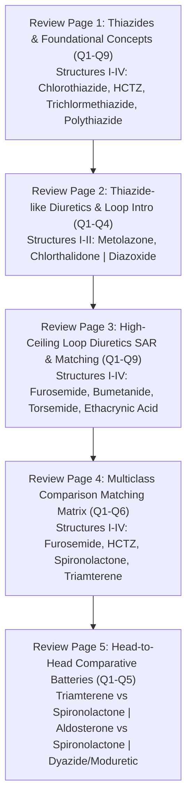

# Exam 2 Diuretics Review Module Benchmark Overhaul — Design Specification

- **Module ID**: `antihypertensives_1_mcp2`
- **Module Title**: Review for Antihypertensive Drugs I (Diuretics)
- **Source Document**: `3) Review for Antihypertensive Drugs I.pdf` (Dr. Rami A. Al-Horani, Medicinal Chemistry MCP II, Fall 2026)
- **Date**: 2026-11-07
- **Status**: Draft (Awaiting User Approval)
- **Selected Approach**: Approach A (1:1 alignment with Dr. Al-Horani's 5-page Review PDF)

---

## 1. Executive Summary & Problem Statement

The Exam 1 Respiratory Drugs review overhaul established a gold-standard benchmark in the MCP Review Platform: authentic 1:1 page-by-page alignment with Dr. Al-Horani's review document, clean Roman numeral chips (`Structure I` to `Structure IV`) in drag-and-drop matching matrices, zero parenthetical drug name spoilers in question stems/options, and sequential `Question N` numbering.

An audit of the current Diuretics review module (`src/data/exam2/diureticsModuleData.ts`) reveals key departures from the source review PDF (`3) Review for Antihypertensive Drugs I.pdf`):
1. **Arbitrary Page Clumping**: The 5-page source review PDF was compressed into 3 synthetic pages (9, 13, and 11 questions), creating crowded views instead of uncrowded slide-workbench layouts.
2. **Drug Name Spoilers**: Multiple-choice questions give away structure identities in stems and option choices (e.g., `(I: Chlorothiazide, II: HCTZ, III: Trichlormethiazide, IV: Polythiazide)` and `Most potent: Polythiazide (IV); Least potent: Chlorothiazide (I)`).
3. **Missing Drag-and-Drop Matching**: Questions 23–27 (comparing Loop, Thiazide, Aldosterone Antagonist, and ENaC blocker) and Questions 14–20 (Loop diuretic properties) were implemented as disconnected multiple-choice questions naming the drugs rather than interactive Drag-and-Drop matching matrices.
4. **Nomenclature Inconsistency**: Questions carry continuous lecture numbers (Questions 1–33 across pages) rather than clean sequential `Question N` per review page.

---

## 2. Approaches Considered

| Approach | Description | Pros | Cons | Decision |
|---|---|---|---|---|
| **Approach A: 1:1 Page Alignment (5 Pages)** | Restructure module into 5 authentic review pages matching Dr. Al-Horani's 5 PDF pages. Convert multiclass and loop property comparisons to Drag-and-Drop matching matrices with Roman numeral chips. Sanitize all spoilers and standardize sequential `Question N`. | Exact 1:1 fidelity with Dr. Al-Horani's review document; matches Exam 1 & Exam 3 benchmarks; uncrowded layout; authentic Drag & Drop pedagogy. | Requires refactoring 3 clumped pages into 5 authentic pages. | **SELECTED (User Approved)** |
| **Approach B: In-Place 3-Page Refactor** | Keep existing 3-page layout; sanitize question stems and options in place; add Drag & Drop on Page 3. | Smaller file diff. | Leaves pages crowded (11–13 questions per page); diverges from the 5 review pages in Dr. Al-Horani's PDF. | Rejected |

---

## 3. Structural Architecture: 5 Review Pages

The module will be partitioned into exactly **5 Review Pages** mirroring the 5 pages of `3) Review for Antihypertensive Drugs I.pdf`:



---

## 4. Page-by-Page Detailed Specification

### Review Page 1: Pharmacophores, Prototypes & Thiazide Diuretics SAR (Questions 1–9)
- **Source**: `3) Review for Antihypertensive Drugs I.pdf`, Page 1.
- **Structures Displayed**:
  - `Structure I`: Chlorothiazide (`chlorothiazide`)
  - `Structure II`: Hydrochlorothiazide (`hydrochlorothiazide`)
  - `Structure III`: Trichlormethiazide (`trichlormethiazide`)
  - `Structure IV`: Polythiazide (`polythiazide`)
- **Questions**:
  1. `Question 1` (Multiple Choice): Definition of a Pharmacophore (IUPAC 3D constellation required for pharmacological activity).
  2. `Question 2` (Multiple Choice): Definition of a Prototype Drug (True/False).
  3. `Question 3` (Multiple Choice): Chemical Class of Structures I–IV (Benzothiadiazine-1,1-dioxide). *Stem sanitized: no parenthetical drug names.*
  4. `Question 4` (Multiple Choice): Mechanistic Class of Structures I–IV (Thiazide diuretics / NCC inhibitors in distal convoluted tubule). *Stem sanitized: no parenthetical drug names.*
  5. `Question 5` (Multiple Choice): Potency Extremes: Most Potent vs Least Potent (`Structure IV` vs `Structure I`). Options use clean Roman numerals (`Most potent: Structure IV; Least potent: Structure I`).
  6. `Question 6` (Multiple Choice): Duration of Action Extremes: Longest vs Shortest Duration (`Structure IV` vs `Structure I` & `Structure II`). Options use clean Roman numerals.
  7. `Question 7` (Ranking): Diuretic Potency Ranking (`Structure IV` > `Structure III` > `Structure II` > `Structure I`).
  8. `Question 8` (Ranking): Duration of Action Ranking (`Structure I` & `II` [6–12h] < `Structure III` [24h] < `Structure IV` [24–36h]).
  9. `Question 9` (Sub-statements, 6 items): Thiazide Diuretics True/False Battery (NaCl reabsorption site, acidity, metabolic stability, 3,4-double bond saturation, C1 sulfonyl replacement, heterocycle necessity).

---

### Review Page 2: Thiazide-like Diuretics & High-Ceiling Loop Diuretics Introduction (Questions 1–4)
- **Source**: `3) Review for Antihypertensive Drugs I.pdf`, Page 2.
- **Structures Displayed**:
  - Panel A: `Structure I`: Metolazone (`metolazone`), `Structure II`: Chlorthalidone (`chlorthalidone`)
  - Panel B: Diazoxide (`diazoxide` - inactive congener lacking diuretic activity)
- **Questions**:
  1. `Question 1` (Sub-statements, 5 items): Metolazone (Drug I) vs Chlorthalidone (Drug II) True/False Battery (loop vs thiazide-like, DCT target, acidity/sulfonamide, quinazolinone vs phthalimidine, bioavailability & RBC carbonic anhydrase binding).
  2. `Question 2` (Multiple Choice): Molecule Lacking Substantial Diuretic Activity (Diazoxide: vasodilator / K_ATP channel opener due to lack of 7-sulfamoyl or presence of 3-methyl).
  3. `Question 3` (Multiple Choice): Chemical Class of Loop Diuretics I & II (Sulfamoyl anthranilic acid / aminobenzoic acid derivatives).
  4. `Question 4` (Multiple Choice): Mechanistic Class of Loop Diuretics (Inhibition of Na+/K+/2Cl- symporter NKCC2 in thick ascending limb of Henle).

---

### Review Page 3: High-Ceiling Loop Diuretics SAR & Matching Matrix (Questions 1–9)
- **Source**: `3) Review for Antihypertensive Drugs I.pdf`, Page 3 (Questions 14–22).
- **Structures Displayed**:
  - `Structure I`: Furosemide (`furosemide`)
  - `Structure II`: Bumetanide (`bumetanide`)
  - `Structure III`: Torsemide (`torsemide`)
  - `Structure IV`: Ethacrynic Acid (`ethacrynic_acid`)
- **Questions**:
  1. `Question 1` (Drag & Drop Matching Matrix): Loop Diuretics Landmark Properties Matching:
     - Target 1: *Most potent loop diuretic congener (~40x furosemide)* $\rightarrow$ `Structure II` (Bumetanide)
     - Target 2: *Sulfonylurea congener with longest duration of action and negligible ototoxicity* $\rightarrow$ `Structure III` (Torsemide)
     - Target 3: *Phenoxyacetic acid derivative / Michael acceptor lacking a sulfonamide group (safe in severe sulfa allergy)* $\rightarrow$ `Structure IV` (Ethacrynic acid)
     - Target 4: *Amphoteric anthranilic acid prototype bearing both a carboxylic acid and secondary amine* $\rightarrow$ `Structure I` (Furosemide)
     - Target 5: *Irreversible alkylating diuretic associated with highest risk of permanent ototoxicity* $\rightarrow$ `Structure IV` (Ethacrynic acid)
  2. `Question 2` (Multiple Choice): Potency Comparison of Structures I–III (`Structure II` is ~40x more potent than `Structure I`). Options use clean Roman numerals.
  3. `Question 3` (Ranking): Diuretic Potency Ranking of Structures I–III (`Structure II` > `Structure III` > `Structure I`).
  4. `Question 4` (Multiple Choice): Longest Duration of Action among Structures I–IV (`Structure III` Torsemide, t1/2 ~3.5–4h, duration 6–8h).
  5. `Question 5` (Multiple Choice): Irreversible Diuretic Mechanism (Structure IV Michael addition reaction with sulfhydryl groups of renal enzymes).
  6. `Question 6` (Multiple Choice): Loop Diuretic for Patients with Severe Sulfa Hypersensitivity (`Structure IV` Ethacrynic acid).
  7. `Question 7` (Multiple Choice): Highest Ototoxicity Risk (`Structure IV` Ethacrynic acid).
  8. `Question 8` (Sub-statements, 5 items): Loop Diuretics True/False Battery (ascending limb of Henle target, acidic nature, hepatic vs renal clearance, highest efficacy / high-ceiling, rapid onset).
  9. `Question 9` (Multiple Choice): Simplest Form of Loop Diuretics (5-sulfamoylamino benzoic acid / anthranilic acid core).

---

### Review Page 4: Multiclass Comparative Matching Matrix & Efficacy (Questions 1–6)
- **Source**: `3) Review for Antihypertensive Drugs I.pdf`, Page 3 bottom (Questions 23–28).
- **Structures Displayed**:
  - `Structure I`: Furosemide (`furosemide` - Loop Diuretic)
  - `Structure II`: Hydrochlorothiazide (`hydrochlorothiazide` - Thiazide Diuretic)
  - `Structure III`: Spironolactone (`spironolactone` - Mineralocorticoid Receptor Antagonist)
  - `Structure IV`: Triamterene (`triamterene` - ENaC Blocker)
- **Questions**:
  1. `Question 1` (Drag & Drop Matching Matrix): Multiclass Diuretic Pharmacological Classification:
     - Target 1: *High-ceiling loop diuretic inhibiting the Na+/K+/2Cl- (NKCC2) symporter in the thick ascending limb* $\rightarrow$ `Structure I`
     - Target 2: *Thiazide diuretic inhibiting the electroneutral Na+/Cl- (NCC) cotransporter in the distal convoluted tubule* $\rightarrow$ `Structure II`
     - Target 3: *Steroidal mineralocorticoid receptor antagonist converted to active canrenone metabolite* $\rightarrow$ `Structure III`
     - Target 4: *Pteridine-based basic ENaC channel blocker combined with thiazides to prevent hypokalemia* $\rightarrow$ `Structure IV`
  2. `Question 2` (Multiple Choice): Potassium-Sparing Diuretic with Active Metabolite (`Structure III` Spironolactone $\rightarrow$ Canrenone).
  3. `Question 3` (Multiple Choice): Ascending Limb of Henle Target (`Structure I`).
  4. `Question 4` (Multiple Choice): Acidic vs Basic Diuretics (Acidic: `Structure I` & `Structure II`; Basic: `Structure IV`).
  5. `Question 5` (Multiple Choice): Combination Partners to Counter Potassium Loss (`Structure III` and `Structure IV` combined with `Structure II`).
  6. `Question 6` (Ranking): Diuretic Efficacy (% Fractional Sodium Excretion) Ranking (`Structure I` [~20–25%] > `Structure II` [~5–8%] > `Structure III` / `Structure IV` [~2–3%]).

---

### Review Page 5: Head-to-Head Comparative Batteries & Combination Therapy (Questions 1–5)
- **Source**: `3) Review for Antihypertensive Drugs I.pdf`, Pages 4–5 (Questions 29–33).
- **Structures Displayed**:
  - Panel A: `Structure I`: Triamterene (`triamterene`), `Structure II`: Spironolactone (`spironolactone`)
  - Panel B: `Molecule I`: Aldosterone (`aldosterone`), `Molecule II`: Spironolactone (`spironolactone`)
  - Panel C: `Drug I`: Amiloride (`amiloride`), `Drug II`: Eplerenone (`eplerenone`)
  - Panel D: Combination: `Drug I`: Triamterene (`triamterene`), `Drug II`: HCTZ (`hydrochlorothiazide`) (Dyazide)
- **Questions**:
  1. `Question 1` (Sub-statements, 5 items): Triamterene (Drug I) vs Spironolactone (Drug II) Battery (pteridine ENaC vs steroidal MR antagonist, collecting duct target, basic vs neutral/lipophilic, active metabolites, potency comparison).
  2. `Question 2` (Sub-statements, 5 items): Aldosterone (Molecule I) vs Spironolactone (Molecule II) Battery (natural steroidal agonist vs competitive antagonist, collecting duct site, diuretic utility, anti-androgenic side effects).
  3. `Question 3` (Sub-statements, 6 items): Amiloride (Drug I) vs Eplerenone (Drug II) Battery (guanidine/pyrazine vs 9,11-epoxysteroid, ascending limb vs collecting duct, active metabolites, hyperkalemia risk, receptor vs transporter, endocrine side effects).
  4. `Question 4` (Multiple Choice): Molecular Basis for Extended Duration vs Short Half-Life (Extensive tissue/protein binding, active metabolites with prolonged biological half-lives, and genomic nuclear transcription latency for mineralocorticoid antagonists).
  5. `Question 5` (Sub-statements, 7 items): Dyazide (Triamterene + HCTZ) / Moduretic (Amiloride + HCTZ) Combination Battery (potassium-sparing + thiazide synergy, distinct tubular sites, basic vs acidic, potassium balance adjustment, sulfa allergy risk).

---

## 5. Drag-and-Drop Matching Data Model Alignment

Matching questions follow the verified Exam 1/Exam 3 schema:
```typescript
{
  id: 331,
  questionNumberLabel: 'Question 1',
  type: 'matching',
  title: 'High-Ceiling Loop Diuretics Landmark Properties Matching',
  prompt: 'Drag each chemical structure (Structure I - Structure IV) to its matching medicinal chemistry or clinical pharmacology property:',
  options: [
    'Structure I',
    'Structure II',
    'Structure III',
    'Structure IV'
  ],
  matchingPairs: [
    {
      target: 'Most potent loop diuretic congener (~40x furosemide)',
      correctAnswer: 'Structure II',
      acceptedStructureIds: ['Structure II', 'bumetanide'],
      rationale: 'Bumetanide (Structure II) features a 4-butylamino and 3-phenoxy group, conferring ~40-fold greater potency than furosemide.'
    },
    ...
  ]
}
```

---

## 6. Cache Invalidation & Storage Migration

- **Module Version Bump**: Set `version: '2.0.0'` on `getDefaultDiureticsModule()`.
- **Storage Hook**: Add migration check in `src/utils/moduleStorage.ts` ensuring that any cached `antihypertensives_1_mcp2` in Dexie or `localStorage` with `version !== '2.0.0'` or `pages.length < 5` is purged and updated to the fresh 5-page module upon initialization.

---

## 7. Verification & Testing Strategy

- **Automated Unit Test**: `tests/diureticsReviewModule.test.ts`
  - Validates `id === 'antihypertensives_1_mcp2'`.
  - Asserts `pages.length === 5`.
  - Asserts all 33 questions have valid `questionNumberLabel === 'Question N'` sequentially numbered on every page.
  - Verifies zero parenthetical drug name spoilers in multiple-choice options for structure-identification questions.
  - Verifies drag-and-drop matching questions have clean Roman numeral `options` and dual-compatible `acceptedStructureIds`.
  - Verifies all 18 chemical structures render correctly with valid SMILES/SMARTS.
- **Regression Suite**: `tests/matchingAuditExam1And2.test.ts`, Exam 1 suites, and `npm run build`.

---

Please review this design specification. Once approved, I will invoke `superpowers:writing-plans` to generate the detailed implementation plan.
