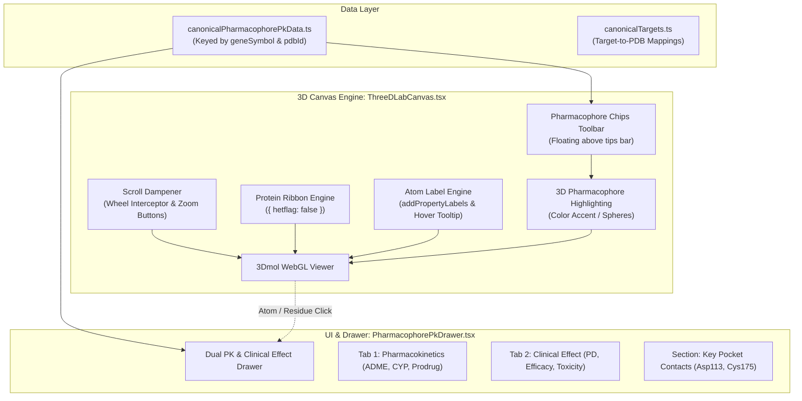

# Design Spec: 3D Lab Atom Labels, Scroll Sensitivity, Ribbon Fix & Pharmacophore PK/PD Drawer

**Date:** 2026-11-13  
**Status:** In Review  
**Target Branch:** `feat/3d-lab-pharmacophore-pk-and-controls`  
**Base Commit:** `67ce5cc` (on `main`)  

---

## 1. Executive Summary & Intent

Students using the 3D Molecular Lab need to move beyond passive 3D viewing to active, exam-relevant chemical-to-clinical reasoning. This design enhances the 3D canvas with:
1. **Protein Ribbon Visibility Fix:** Correcting the 3Dmol selector from `{ protein: true }` to `{ hetflag: false }` so the receptor cartoon displays reliably.
2. **Smooth Scroll Sensitivity & Zoom Controls:** Dampening the jumpy mouse-wheel zoom by intercepting the container's wheel events, plus adding explicit on-canvas `+` / `−` zoom buttons.
3. **Viewable Atom Names:** An on-canvas toggle displaying atom identifiers (`C1`, `N2`, `O3`, `Cl`) on the ligand using 3Dmol's `addPropertyLabels("atom")`, along with interactive hover/click atom inspection.
4. **Interactive Pharmacophore Tags with Dual PK & Clinical Effect Drawer:** A docked bar of functional group chips for the active drug; clicking a chip highlights matching atoms in 3D (pulsing spheres / thick accent sticks) and opens a slide-out drawer featuring dual **Pharmacokinetics (PK)** and **Clinical Effect (PD)** breakdowns.
5. **Key Pocket Residue Annotations:** Interactive annotations for critical pocket amino acids (e.g., `Asp113`, `Cys175`, `Zn²⁺`, `Glu384`) explaining the interaction type and clinical outcome of disrupting that bond.

---

## 2. Goals, Non-Goals & Anti-Goals

### Goals
- **Instant Ribbon Rendering:** Ensure toggling "Toggle Protein Ribbon" renders the secondary structure cartoon with 60% opacity without failures or blank views.
- **Silky-Smooth Camera Zooming:** Provide predictable, dampened scroll zoom (~60% lower sensitivity than 3Dmol default) and physical `+` / `−` zoom buttons for accessibility.
- **Atom Names On Demand:** Allow students to toggle atom name labels on the drug ligand to orient themselves within complex chemical scaffolds.
- **Dual PK & Clinical Effect Education:** Enable students to click a pharmacophore tag and immediately see how that exact functional group dictates oral absorption, CYP metabolism, prodrug cleavage, systemic pharmacodynamics, and clinical adverse effects.
- **Pocket Residue Clinical Significance:** Connect 3D spatial contacts (H-bonds, salt bridges, covalent bonds) to clinical pharmacology (e.g. why mutating a specific residue abolishes drug efficacy).

### Non-Goals
- Real-time docking simulations or molecular dynamics (the lab visualizes experimentally validated RCSB co-crystal structures).
- Live fetching of unstructured OpenFDA regulatory text (all data is curated, structured, and instant).

### Anti-Goals
- Do not clutter the 3D canvas with unreadable 3D text overlays; all detailed PK and PD pharmacology belongs in the slide-out drawer.
- Do not freeze the WebGL scene or block user rotation/panning when the drawer is open.

---

## 3. Approaches Considered & Trade-offs

| Approach | Architecture | Trade-offs | Ruling |
| :--- | :--- | :--- | :--- |
| **Approach 1: Curated MedChem Data Pipeline with Dual PK & Clinical Effect Drawer** | Enriched offline dictionary of pharmacophore PK/PD and pocket contacts + 3Dmol event/selector enhancements + slide-out drawer. | Zero latency, reliable, high-yield alignment with pharmacy curriculum; requires structured data curation. | **Selected (Recommended)** |
| **Approach 2: Dynamic Live API Enrichment (OpenFDA & ChEMBL)** | Fetch unstructured drug labels and mechanism data dynamically via REST. | High latency, network failure risks, and regulatory text is not atom-specific. | Rejected |
| **Approach 3: Pure 3D Canvas Overlays & Tooltips** | Embed short PK/PD notes directly as 3D WebGL labels over atoms without a drawer. | Highly cramped, illegible on mobile/small screens, cannot display multi-step metabolic pathways. | Rejected |

---

## 4. Architectural & Component Specification



### 4.1. Builder Resolutions & Conflict Settle Calls
- **Resolution 1 (PDB & Target Keying):** `canonicalPharmacophorePkData.ts` keys profiles primarily by canonical `geneSymbol` (e.g. `'P2RY12'`, `'ACE'`, `'AGTR1'`, `'HMGCR'`, `'ADRB1'`, `'PTGS2'`, `'DHFR'`, `'EGFR'`) with secondary lookup by `pdbId`. This ensures 100% data discovery across all target selection paths in `ThreeDLabLibrary` (`1O86`, `4Z9O`, `1HWK`, `7JJO`, `3LN1`, `1U72`, `1M17`).
- **Resolution 2 (Ligand Atom Mapping & Fallback):** Atom names are mapped to the actual PDB HETATM coordinates of the target co-crystal structures (e.g. `AZD` in `4NTJ`, `1N4` in `1O86`, `4Z9` in `4Z9O`, `1HW` in `1HWK`, `CEL` in `3LN1`). For educational continuity, descriptions teach both the co-crystal SAR and class prototype drugs (e.g., Clopidogrel vs AZD1283). If any atom name is not found in the loaded PDB, 3Dmol falls back gracefully to highlighting the full ligand stick structure with colored glow rather than failing silently.
- **Resolution 3 (Right Drawer Coexistence):** To prevent layout collisions or squishing the 3D canvas, right-side drawer state is coordinated as mutually exclusive: opening the Pharmacophore PK Drawer closes or slides back the ChEMBL SAR drawer (and vice versa). In fullscreen mode, each has its own slide-out tab trigger on the right edge (`Pharmacophore PK` and `ChEMBL SAR`). In regular mode, the PK drawer slides out as an overlay with backdrop or occupies the right column.
- **Resolution 4 (Toolbar Placement & Custom PDBs):** The Pharmacophore Chips Toolbar floats smoothly over the bottom of the WebGL canvas, above the navigation tips bar. When an uncurated custom PDB is loaded, the toolbar is cleanly hidden without displaying empty errors.

### 4.2. 3Dmol Engine Enhancements (`src/components/ThreeDLabCanvas.tsx`)

1. **Protein Ribbon Selector Fix**:
   - Change `viewer.setStyle({ protein: true }, ...)` to:
     ```ts
     viewer.setStyle(
       { hetflag: false },
       { cartoon: { color: 'spectrum', opacity: 0.6 } }
     );
     ```
   - When ribbon is toggled off:
     ```ts
     viewer.setStyle({ hetflag: false }, {});
     ```
   - This ensures standard amino acid polymer chains are correctly matched by 3Dmol's parser.

2. **Scroll Sensitivity Dampening**:
   - Intercept the `wheel` event on `containerRef.current` with `{ passive: false, capture: true }`:
     ```ts
     const handleWheel = (e: WheelEvent) => {
       e.preventDefault();
       e.stopPropagation();
       const sensitivity = 0.04; // Dampened by ~60%
       const zoomFactor = 1.0 - Math.sign(e.deltaY) * sensitivity;
       if (viewerRef.current) {
         viewerRef.current.zoom(zoomFactor);
         viewerRef.current.render();
       }
     };
     ```
   - Provide visual `+` / `−` zoom buttons floating in the bottom-right corner of the canvas.

3. **Atom Names Visibility**:
   - Add state: `showAtomLabels: boolean` (defaults to false).
   - Add header button: `"Atom Labels"` (with `Tag` icon and active state indicator).
   - When enabled:
     ```ts
     viewer.addPropertyLabels("atom", { resn: detectedLigand.resn }, {
       fontColor: 'white',
       backgroundOpacity: 0.75,
       backgroundColor: '#0f172a',
       fontSize: 10,
       alignment: 'center'
     });
     ```
   - On atom click / hover: Display a floating pill above the atom with `atom.atom` (e.g. `C12`), element, and residue name.

4. **3D Pharmacophore Accent Highlighting**:
   - When a pharmacophore group is selected:
     - Apply distinct accent styling to its atoms (e.g., magenta or amber carbon sticks/spheres):
       ```ts
       viewer.setStyle(
         { resn: detectedLigand.resn, atom: activeGroup.atomNames },
         { stick: { colorscheme: 'magentaCarbon', radius: 0.35 } }
       );
       ```
     - Zoom camera smoothly toward the highlighted group.

---

### 4.2. Data Model (`src/types/structure3d.ts`)

```ts
export interface PharmacophorePkPdGroup {
  id: string;
  name: string;
  chemicalFormula?: string;
  atomNames: string[]; // Specific atom IDs in the PDB HETATM record (e.g. ['S1', 'C2', 'C3'])
  colorAccent?: string; // Hex color for 3D highlight (e.g. '#ec4899')
  pharmacokinetics: {
    absorption: string;      // e.g. "Moderate oral bioavailability; high lipophilicity (LogP ~3.8)"
    metabolism: string;      // e.g. "Primary oxidation site for CYP2C19 & CYP1A2; 85% esterase shunting"
    prodrugRole?: string;    // e.g. "Masks active free thiol required for covalent disulfide bonding"
    halfLifeAndClearance: string; // e.g. "Elimination t1/2 ~6h; permanent platelet inactivation lasts 7-10d"
  };
  clinicalPharmacodynamics: {
    targetBindingRole: string; // e.g. "Forms covalent disulfide bridge with Cys17 and Cys270 in P2Y12"
    physiologicEffect: string; // e.g. "Prevents ADP-mediated platelet activation, aggregation, and arterial thrombosis"
    adverseEffectRisks: string; // e.g. "Severe bleeding risk; black box warning for CYP2C19 poor metabolizers (*2/*3)"
  };
}

export interface KeyPocketResidueContact {
  resi: number;
  resn: string; // e.g. 'CYS', 'ASP', 'ARG', 'ZN'
  chain?: string;
  label: string; // e.g. 'Cys175 (Covalent Disulfide Anchor)'
  interactionType: 'covalent' | 'ionic' | 'hydrogen-bond' | 'pi-stacking' | 'coordination' | 'hydrophobic';
  clinicalImpact: string; // e.g. "Essential nucleophile; mutation to Ala completely blocks irreversible inhibition"
}

export interface TargetMedChemProfile {
  targetPdbId: string;
  drugName: string;
  ligandCode: string;
  pharmacophoreGroups: PharmacophorePkPdGroup[];
  keyPocketResidues: KeyPocketResidueContact[];
}
```

---

### 4.3. Dual PK & Clinical Effect Drawer (`src/components/PharmacophorePkDrawer.tsx`)

- **Placement:** Docked right-hand slide-out drawer inside `ThreeDLabCanvas` (works in both regular and fullscreen modes).
- **Header:**
  - Group name badge (e.g., `Thiophene Ring`, `Carboxylate Warhead`, `Fluorophenyl`).
  - Active drug name and PDB reference.
  - Close button (`X`).
- **Tab Bar:**
  1. **Pharmacokinetics (PK)**:
     - Absorption & Lipophilicity badge.
     - Metabolism & CYP Enzymes breakdown.
     - Prodrug Activation / Inactivation Pathways.
     - Half-life & Clearance dynamics.
  2. **Clinical Effect (PD)**:
     - Mechanism of Action & Pocket Affinity.
     - Downstream Physiological Response on the Body.
     - Adverse Effects & Clinical Safety Warnings.
- **Pocket Contact Inspector Section:**
  - When an amino acid is clicked in the pocket (or selected from the list):
  - Displays residue name (`CYS 175`), interaction type badge (`Covalent Anchor`), and clinical consequence note.
- **Accessibility:**
  - `role="region"`, `aria-label="Pharmacophore PK and Clinical Effect Drawer"`, `Escape` key capture.

---

## 5. Curated Target Coverage

Curated profiles in `src/data/canonicalPharmacophorePkData.ts` for curricular targets:
1. **P2Y12 Receptor (`4NTJ` - Clopidogrel / AZD)**:
   - *Thiophene Ring:* CYP2C19 oxidation warhead, covalent Cys17/Cys270 disulfide, prodrug bioactivation vs. 85% esterase shunting.
   - *Ester Linkage:* Site of hCE1 hydrolytic inactivation into inactive carboxylic acid metabolite.
   - *Chlorophenyl Ring:* Hydrophobic anchor fitting into P2Y12 lipophilic sub-pocket.
2. **ACE (`1UZE` - Enalaprilat / 1N4)**:
   - *Zinc-binding Carboxylate:* Catalytic Zn²⁺ bidentate coordination, $K_i \approx 50\text{ pM}$, vasodilation and dry cough bradykinin accumulation.
   - *Phenethyl Group:* Mimics C-terminal Phe residue, fitting hydrophobic $S_1$ sub-pocket.
   - *Proline Ring:* Fits $S_2'$ pocket, prevents ACE degradation.
3. **AT1 Receptor (`4YAY` - Losartan / 4Z9)**:
   - *Biphenyl Tetrazole:* Acidic mimic of Ang II Asp1 carboxylate, provides high oral stability over carboxylic acid, avoids metabolic glucuronidation.
   - *Imidazole Core:* Scaffold anchoring polar H-bonds with Arg167.
4. **HMG-CoA Reductase (`1HWK` - Atorvastatin / 1HW)**:
   - *Dihydroxyheptanoic Acid:* Transition state mimic of HMG-CoA, coordinates with catalytic residues and Lys735.
   - *Fluorophenyl Group:* Strong hydrophobic $\pi$-stacking with Arg590; fluorine substitution blocks aromatic hydroxylation by CYP3A4.
5. **Beta-1 Adrenoceptor (`2Y03` - Metoprolol / NEN)**:
   - *Ethanolamine Tail:* Essential protonated secondary amine forming critical salt bridge with Asp121.
   - *Methoxyethyl Ether:* Cardioselective para-substituent, metabolized by polymorphic CYP2D6.
6. **COX-2 (`3LN1` - Celecoxib / CEL)**:
   - *Sulfonamide Group:* Inserts into COX-2 specific side-pocket (Val523), confers 375x selectivity over COX-1, carries sulfa allergy warning.
7. **EGFR Kinase (`4I22` - Osimertinib / AQ4)**:
   - *Acrylamide Michael Acceptor:* Forms irreversible covalent bond with Cys797, overcomes T790M resistance.

---

## 6. Verification & Testing Strategy

1. **Unit Tests (`tests/canonicalPharmacophorePkData.test.ts`)**:
   - Verify every canonical target has valid pharmacophore PK/PD groups with non-empty PK and PD fields.
   - Verify atom name mappings exist and key pocket residues have valid interaction types and clinical notes.
2. **Canvas Controls Tests (`tests/threeDLabCanvasControls.test.ts`)**:
   - Verify `{ hetflag: false }` selector is used for cartoon ribbon styling.
   - Verify wheel event listener is attached with `{ passive: false, capture: true }` and dampens zoom.
   - Verify "Atom Labels" button toggles `showAtomLabels` and calls `addPropertyLabels`.
   - Verify zoom `+` / `−` buttons invoke `viewer.zoom()`.
3. **Drawer Integration Tests (`tests/pharmacophorePkDrawer.test.ts`)**:
   - Verify clicking pharmacophore tags triggers atom highlight and opens drawer.
   - Verify tab switching between "Pharmacokinetics" and "Clinical Effect".
   - Verify residue inspection updates the pocket contact card.
   - Verify `Escape` key and close button cleanly close the drawer.
4. **Full Regression & Build**:
   - Run all existing test suites in `tests/`.
   - `npm run lint` (`tsc --noEmit`).
   - `npm run build` (`vite build`).
